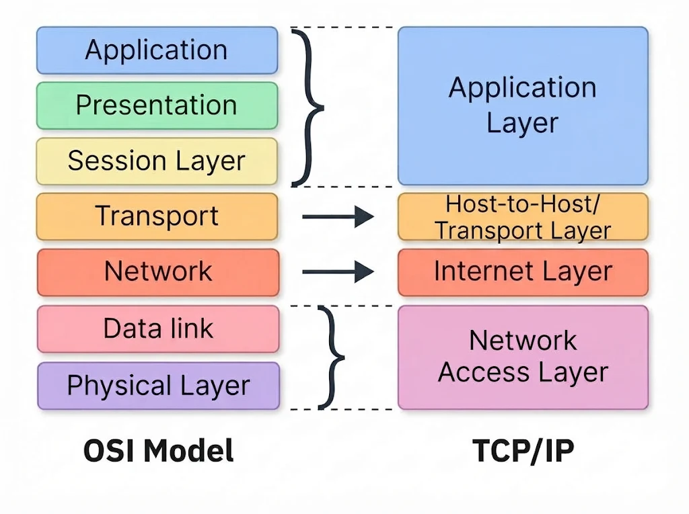
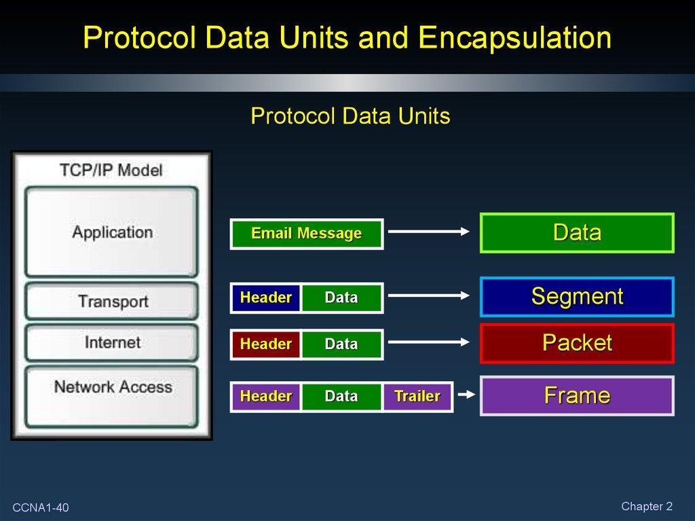
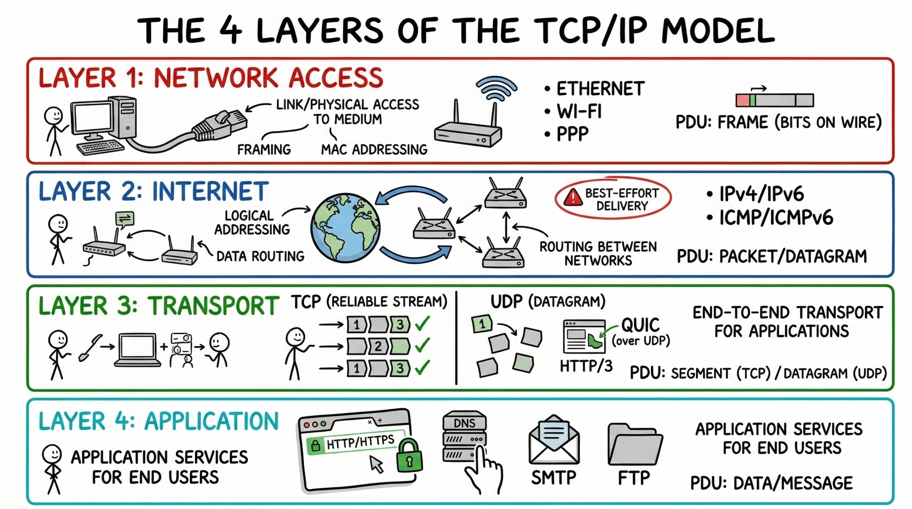

# TCP/IP Model — Complete Notes

## **1. Introduction to TCP/IP Model**

TCP/IP stands for Transmission Control Protocol / Internet Protocol.

- TCP (Transmission Control Protocol) is a Transport Layer protocol.
- IP (Internet Protocol) is an Internet Layer protocol.

TCP and IP are two different protocols that work together as part of the TCP/IP protocol suite.

The TCP/IP Model defines how data is communicated and transmitted between devices over a network, including the Internet.

**Why do we need the TCP/IP Model?**

Before standard networking protocols became widely adopted, different manufacturers could implement their own communication methods.

**For example:**
- An Intel-based device might use a particular communication implementation.
- A Lenovo device might use a different implementation.
- If their communication methods were incompatible, communication would become difficult.

TCP/IP introduced a common set of open networking standards and protocols.

The TCP/IP protocol suite consists of many protocols such as TCP, IP, UDP, DNS, DHCP, HTTP, ARP, etc.

Now, devices manufactured by different companies can communicate with each other, provided they follow compatible networking standards.

This concept is called **Interoperability**.

**Important:** The problem wasn't that Intel and Lenovo devices inherently couldn't communicate. The actual problem was the lack of common communication standards between different networking systems.

---

## **2. Number of Layers in TCP/IP Model**

Unlike the OSI Model, which has exactly 7 layers, TCP/IP is commonly represented using either 4 layers or 5 layers, depending on the reference.

We will follow the 4-Layer TCP/IP Model.

**Mapping of OSI Model and TCP/IP Model**

| OSI Model (7 Layers) | TCP/IP Model (4 Layers) |
| --- | --- |
| Application | Application |
| Presentation | Application |
| Session | Application |
| Transport | Transport |
| Network | Internet |
| Data Link | Network Access |
| Physical | Network Access |

**Explanation:**

1. OSI Application, Presentation and Session Layers combine to form the TCP/IP Application Layer.
2. OSI Transport Layer remains the TCP/IP Transport Layer.
3. OSI Network Layer becomes the TCP/IP Internet Layer.
4. OSI Data Link and Physical Layers combine to form the TCP/IP Network Access Layer.

---

## **3. Data Encapsulation in TCP/IP Model**

When a sender transmits information, data passes through different layers. Each layer performs its own function and adds the necessary information.

The data unit changes as it moves down the layers.

| Layer | Data Unit (PDU) |
| --- | --- |
| Application Layer | Data |
| Transport Layer | Segment (TCP) / Datagram (UDP) |
| Internet Layer | Packet |
| Network Access Layer | Frame → Bits |

**Complete Process:**

1. Application Layer: Information is represented as Data.
2. Transport Layer: Data is divided into Segments (TCP) or Datagrams (UDP).
3. Internet Layer: Source and Destination IP addresses are added, forming an IP Packet.
4. Network Access Layer: The IP Packet is encapsulated into a Frame using link-layer addressing.
5. Physical transmission: The frame is transmitted as Bits (electrical, optical or radio signals).

The actual signal depends on the transmission medium:

- Copper Cable → Electrical signals.
- Optical Fiber → Light signals.
- Wireless → Radio signals.

At the receiver's end, the reverse process takes place, called **Decapsulation**.

---

## **4. Two Important Responsibilities of TCP/IP**

TCP/IP provides two important functions that work together:

### **A. Reliable Data Delivery — TCP**

TCP is responsible for reliable, ordered data delivery between communicating applications.

**Its major responsibilities include:**

- Segmentation: Divides data into smaller segments.
- Sequencing: Maintains the correct order of data.
- Error Detection: Detects corrupted data using checksums.
- Acknowledgement: Receiver acknowledges successfully received data.
- Retransmission: Lost data can be retransmitted.
- Flow Control: Prevents a fast sender from overwhelming a slow receiver.
- Connection Establishment: Establishes a connection using the Three-Way Handshake.

### **B. Addressing and Packet Delivery — IP**

IP (Internet Protocol) is responsible for logical addressing and delivering packets across interconnected networks.

Its responsibilities include:

- Assigning logical source and destination IP addresses to packets.
- Enabling routers to forward packets towards their destination.
- Supporting communication between different networks.
- Providing connectionless, best-effort packet delivery.

**Important distinction:**

TCP handles reliable data delivery between endpoints, whereas IP handles addressing and packet forwarding across networks.

---

## **5. Key Features of TCP/IP**

### **A. End-to-End Communication**

TCP/IP allows two end devices to communicate without requiring the sender to know the addresses of every intermediate router.

**For example:**

Suppose Device A wants to communicate with Device B.

Device A needs the destination IP address of Device B. Routers in between examine the destination IP address and forward packets towards the destination.

The sender does not need to manually specify every router through which the packet will travel.

The endpoints handle communication, while intermediate routers handle packet forwarding.

Also, in TCP communication, the sender and receiver exchange acknowledgements to confirm successful data delivery.

There is no requirement for a centralized system to verify every communication.

### **B. Dynamic Routing**

Dynamic Routing allows routers to learn and update network routes automatically using routing protocols.

**For example:**

Suppose Router A has multiple possible paths to reach Router D.

- Route 1 becomes unavailable.
- The routing protocol can identify the failure.
- Routers can calculate and select another available route.

This improves network reliability and adaptability.

**Examples of routing protocols:**

- OSPF
- RIP
- BGP
- EIGRP

**Note:** Dynamic routing is not performed by TCP. Routing protocols exchange routing information, and routers use their routing tables to forward IP packets.

---

## **6. Five Major Networking Problems Addressed by TCP/IP**

TCP/IP networking standards and associated protocols help solve several important networking problems.

### **1. Addressing**

Every device communicating across an IP network needs a logical IP address.

However, communication over a local Ethernet network also requires MAC addressing.

Different protocols perform different addressing functions:

| Protocol | Function |
| --- | --- |
| IP | Provides logical addressing (IPv4/IPv6). |
| ARP | Resolves IPv4 addresses into MAC addresses on a local network. |
| RARP | Historically resolved MAC addresses into IP addresses; now largely obsolete. |
| DHCP | Automatically assigns IP addresses and other network configuration. |

**Example:**

If Device A knows the IPv4 address of Device B but needs its MAC address for local delivery, it can use ARP.

DHCP is different: it helps a device obtain its IP configuration automatically.

### **2. Routing**

Routing determines the path through which packets can travel from a source network to a destination network.

**For example:**

Device A (Network A) wants to communicate with Device B (Network B).

Routers examine the destination IP address and use their routing tables to decide where to forward the packet.

Routing protocols help routers learn available routes.

### **3. Name Resolution**

Humans generally use domain names, whereas IP networking uses IP addresses for packet delivery.

**For example:**

`www.facebook.com`

A router does not use this domain name to perform normal IP forwarding. It forwards packets using IP addresses.

DNS (Domain Name System) resolves domain names into IP addresses.

This makes accessing websites easier because users don't need to remember numerical IP addresses.

### **4. Flow Control**

Flow Control ensures that a sender does not overwhelm a receiver with data.

**For example:**

- Sender can transmit data at 100 Mbps.
- Receiver can process data at only 20 Mbps.

If the sender continuously transmits at 100 Mbps, the receiver may become overwhelmed.

TCP uses a mechanism called the Sliding Window / Receiver Window to regulate how much unacknowledged data can be sent.

This helps the receiver process incoming data efficiently.

### **5. Interoperability**

Interoperability means devices from different manufacturers can communicate with each other using common networking standards.

**For example:**

A Lenovo laptop can communicate with an Intel-based desktop, a Dell server or an Apple device.

This is possible because they follow common networking protocols and standards.

**Important:** TCP itself does not define one universal data format for all devices. Interoperability is achieved through the complete TCP/IP protocol suite and agreed standards.

---

## **7. TCP/IP Model — Layer-by-Layer Explanation**

### **Layer 1: Application Layer**

The Application Layer is the topmost layer of the TCP/IP Model.

It provides network services to user applications and acts as the interface between applications and the network.

**Main Functions:**

- Provides network services to applications.
- Supports communication between applications running on different devices.
- Handles application-level protocols.
- Combines the functions of OSI Application, Presentation and Session Layers.

**Examples of Protocols:**

| Protocol | Function |
| --- | --- |
| HTTP / HTTPS | Web communication |
| FTP | File Transfer |
| SMTP | Sending Emails |
| DNS | Domain Name Resolution |
| DHCP | Automatic IP Configuration |
| SSH | Secure Remote Access |

**Important Points:**

- The sender's application generates data that enters the TCP/IP stack through the Application Layer.
- The receiver's application ultimately receives the data through its Application Layer.
- Protocols like HTTP, DNS and SMTP operate at the Application Layer.

### **Layer 2: Transport Layer (Host-to-Host Layer)**

The Transport Layer provides communication between applications running on different hosts.

It uses two major protocols:

**1. TCP (Transmission Control Protocol)**

TCP is a connection-oriented and reliable transport protocol.

It establishes a connection using the Three-Way Handshake.

**Its major functions include:**

- Segmentation
- Sequencing
- Acknowledgement
- Retransmission
- Flow Control
- Error Detection

**2. UDP (User Datagram Protocol)**

UDP is a connectionless transport protocol.

It provides faster, lightweight communication without establishing a connection using a Three-Way Handshake.

**Its major characteristics:**

- No connection establishment.
- No guaranteed delivery.
- No guaranteed ordering.
- Lower protocol overhead than TCP.

**Data Units:**

- TCP → Segment
- UDP → Datagram

### **Layer 3: Internet Layer**

The Internet Layer is responsible for logical addressing and packet delivery across different networks.

The primary protocol is IP (Internet Protocol).

**Main Functions:**

- Adds source and destination IP addresses.
- Supports routing and packet forwarding.
- Enables communication between different networks.
- Provides connectionless, best-effort delivery.

**Important Protocols:**

| Protocol | Function |
| --- | --- |
| IP | Logical addressing and packet delivery |
| ICMP | Error reporting and network diagnostics |
| IGMP | IPv4 multicast group management |
| IPsec | Security for IP communication |

**Important:**

IP is a connectionless protocol, unlike TCP.

IP does not establish a connection before sending packets. Each packet is forwarded independently based on its destination IP address.

Also, IP itself does not guarantee delivery, ordering or retransmission.

### **Layer 4: Network Access Layer**

The Network Access Layer is the bottommost layer of the 4-layer TCP/IP Model.

It combines the functions of the OSI Data Link and Physical Layers.

**Main Functions:**

- Handles communication over the local network.
- Uses MAC addresses for local link-layer delivery.
- Encapsulates IP packets into frames.
- Handles transmission of bits over the physical medium.

**Important Protocols and Technologies:**

- Ethernet
- Wi-Fi (IEEE 802.11)
- PPP
- ARP (associated with local IPv4 address resolution)

**Data Units:**

- Data Link → Frame
- Physical → Bits

The actual transmission takes place using electrical signals, light signals or radio waves, depending on the medium.

---

## **8. Sender and Receiver Communication**

One important correction to remember:

The sender is not permanently connected only to the Application Layer, and the receiver is not permanently connected only to the Network Access Layer.

Both sender and receiver use the complete TCP/IP stack.

**Sender Side:**

- Data enters through the Application Layer.
- Moves through the Transport Layer.
- Then through the Internet Layer.
- Finally reaches the Network Access Layer.
- Gets transmitted as bits.

**Receiver Side:**

- Bits are received at the Network Access Layer.
- The frame is processed and decapsulated.
- The IP packet reaches the Internet Layer.
- The segment/datagram reaches the Transport Layer.
- Finally, the original application data is delivered to the receiver's Application Layer.

This process is called **Encapsulation** at the sender and **Decapsulation** at the receiver.

---

## **9. Important Technical Corrections**

**Ye tumhare original explanation mein kuch points the jinhe technically correct karna zaroori tha.**

| Your original understanding | Correct understanding |
| --- | --- |
| TCP defines a common data format for devices. | TCP provides reliable, ordered delivery, segmentation and related transport functions. Common standards enable interoperability. |
| IP is connection-oriented like TCP. | IP is connectionless. TCP is connection-oriented. |
| DHCP resolves IP addresses into MAC addresses. | ARP resolves IPv4 to MAC. DHCP assigns IP configuration. |
| IP protocol defines the complete route. | Routing protocols help routers learn routes; routers use routing tables for forwarding. |
| Dynamic routing is a TCP/IP feature. | Dynamic routing is achieved using routing protocols such as OSPF, RIP and BGP. |
| Receiver is connected to Network Access Layer. | Data enters the receiver's stack through Network Access and is ultimately delivered to its Application Layer. |
| Every Internet-related protocol operates at Application Layer. | Many do, but ARP, ICMP and IP operate at lower layers. |

**Some additional concepts to remember**

1. TCP vs IP: TCP provides reliable transport; IP provides connectionless packet delivery.
2. TCP vs UDP: TCP uses Segments, whereas UDP uses Datagrams.
3. ARP vs DHCP: ARP finds a MAC address using an IPv4 address; DHCP provides IP configuration.
4. Routing vs Forwarding: Routing determines available paths; forwarding sends packets to the appropriate next hop.
5. Encapsulation vs Decapsulation: Sender adds headers as data moves down the layers; receiver processes and removes them as data moves up.

**One-line summary:**

- Application Layer → What network services applications need.
- Transport Layer → How application-to-application communication happens.
- Internet Layer → How packets are addressed and delivered across networks.
- Network Access Layer → How data is transmitted over the local network and physical medium.

---

## **10. Quick Revision**

### **TCP/IP Model — 4 Layers**

| Layer | Protocols | Data Unit |
| --- | --- | --- |
| **Application Layer** | HTTP, HTTPS, FTP, DNS, DHCP, SMTP | Data |
| **Transport Layer** | TCP, UDP | Segment / Datagram |
| **Internet Layer** | IP, ICMP, IGMP | Packet |
| **Network Access Layer** | Ethernet, Wi-Fi, PPP, ARP | Frame / Bits |

**Sender:** Top → Bottom  |  **Receiver:** Bottom → Top

---

## 11. References

**Video:** What is TCP/IP Model-Hindi/Urdu | Comparison between OSI and TCP/IP | TCP v/s UDP

**Channel:** Technical Guftugu

**Link:** https://youtu.be/gUOlE3If3yk?si=ZmriXF_gCqi3AdUd
