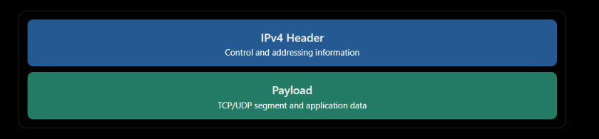
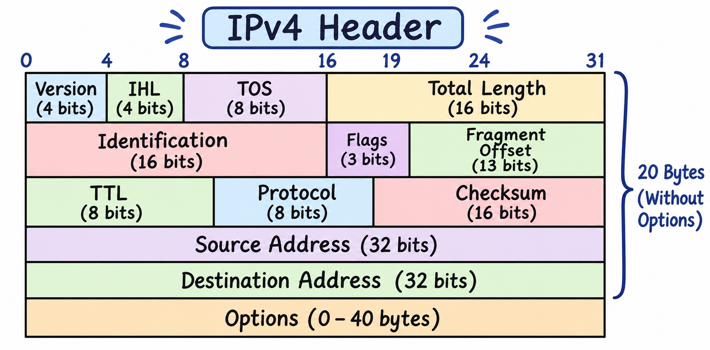

### IPv4 Header

### A. Introduction to IPv4 Header

When a sender sends data, it passes through different layers of the OSI model:

**Application Layer → Presentation Layer → Session Layer → Transport Layer → Network Layer**

- At the Transport Layer, data is divided into segments (in TCP).
- These segments are forwarded to the Network Layer.
- At the Network Layer, an IPv4 header is added to the segment.

The IPv4 packet consists of two main parts:

I. **IPv4 Header:** Contains control and addressing information required for packet delivery.

II. **Payload:** Contains the data received from the upper layer (usually a TCP or UDP segment).

**IPv4 Packet Structure**

**IPv4 Header Size**

- The IPv4 header has a minimum size of 20 bytes.
- Its maximum size can extend up to 60 bytes.
- Therefore, the IPv4 header has a variable length.

The header consists of:

- **20 bytes:** Standard header containing all the mandatory fields.
- **0–40 bytes:** Optional information (Options and Padding).

Generally, IPv4 packets use a 20-byte header when no additional options are required.

**Note:** The IPv4 header contains 12 main fields. The first 20 bytes contain the standard fields, while Options and Padding can extend the header.

### B. Fields of IPv4 Header

The IPv4 header contains the following fields in a fixed order:

I. Version

II. Internet Header Length (IHL)

III. Type of Service (ToS)

IV. Total Length

V. Identification

VI. Flags

VII. Fragment Offset

VIII. Time To Live (TTL)

IX. Protocol

X. Header Checksum

XI. Source IP Address

XII. Destination IP Address

After these fields, optional information can be added.

### C. Explanation of Each Field

### 1. Version

- The Version field specifies which version of IP is being used.
- It identifies whether the packet belongs to IPv4 or IPv6.

| IP Version | Binary Value | Decimal Value |
|---|---|---|
| IPv4 | 0100 | 4 |
| IPv6 | 0110 | 6 |

- The Version field occupies 4 bits.

### 2. Internet Header Length (IHL)

- IHL specifies the length of the IPv4 header in 32-bit words.
- It tells the receiver how long the IPv4 header is and where the payload begins.
- The IHL field occupies 4 bits.

**Scaling Concept:**

Since IHL is a 4-bit field, it can represent values from 0 to 15. However, the actual header length is calculated by multiplying the IHL value by 4 bytes.

**Formula:**

Header Length = IHL Value * 4

**Example:**

If IHL = 6,

6*4 = 24 bytes

Therefore, the IPv4 header length is 24 bytes.

- Minimum IHL value = 5 (20 bytes).
- Maximum IHL value = 15 (60 bytes).

### 3. Type of Service (ToS)

- The Type of Service field specifies how a router should handle or prioritize an IP packet.
- It helps indicate the preferred quality of service (QoS) for a packet.

**For example:**

- **Low Delay:** Useful for applications such as voice and video calls.
- **High Throughput:** Useful for applications that require faster data transfer.
- **High Reliability:** Indicates a preference for reliable delivery.
- **Low Cost:** Indicates a preference for lower-cost transmission.

**Note:** In modern IPv4, this 8-bit field is interpreted as:

- **DSCP (6 bits):** Used for traffic classification and prioritization.
- **ECN (2 bits):** Used for Explicit Congestion Notification.

### 4. Total Length

- The Total Length field specifies the complete size of the IPv4 packet.
- It includes both the IPv4 header and the payload.

Total Length = Header Length + Payload Length

- It occupies 16 bits.
- The maximum IPv4 packet size is 65,535 bytes.

**Example:**

If:

- IPv4 Header = 20 bytes
- Payload = 1,000 bytes

Then:

**Total Length = 20 + 1,000 = 1,020 bytes.**

### 5. Identification

- The Identification field is used during IP fragmentation.
- Sometimes, a complete IP packet cannot be transmitted over a network because it exceeds the Maximum Transmission Unit (MTU) of the network.
- In such situations, the packet may be divided into smaller fragments.

The Identification field assigns the same identification value to all fragments belonging to the same original IP packet.

**Working:**

I. An original IP packet is divided into smaller fragments.

II. All fragments receive the same Identification value.

III. These fragments travel through the network.

IV. At the destination, the Identification field helps the receiver identify which fragments belong to the same original packet.

V. The fragments are reassembled into the original IP packet.

- It occupies 16 bits.

### 6. Flags

- The Flags field controls and provides information about IP fragmentation.
- It occupies 3 bits.

The three bits are:

| Bit | Name | Purpose |
|---|---|---|
| 1st bit | Reserved | Always set to 0 |
| 2nd bit | DF (Don't Fragment) | Indicates whether fragmentation is allowed |
| 3rd bit | MF (More Fragments) | Indicates whether more fragments are following |

**DF (Don't Fragment):**

- DF = 0: Fragmentation is allowed.
- DF = 1: Fragmentation is not allowed.
- If a packet needs fragmentation but DF = 1, the router drops the packet and normally sends an ICMP error message to the sender.

**MF (More Fragments):**

- MF = 0: No more fragments are following.
- MF = 1: More fragments are following.

**Note:** The last fragment has MF = 0, while the preceding fragments have MF = 1.

**Remember:**

- DF tells the router whether it can fragment the packet or not.
- MF tells the receiver whether more fragments are expected or not.

### 7. Fragment Offset

- The Fragment Offset field specifies the position of a fragment within the original IP packet.
- It helps the receiver reassemble fragments in the correct order.
- It occupies 13 bits.

**Example:**

Suppose an original IP packet is divided into four fragments:

| Fragment | Fragment Offset |
|---|---:|
| Fragment 1 | 0 |
| Fragment 2 | 100 |
| Fragment 3 | 200 |
| Fragment 4 | 300 |

These values represent positions in units of 8 bytes, not simple fragment numbers.

**Difference between Identification and Fragment Offset:**

- **Identification:** Identifies which original IP packet a fragment belongs to.
- **Fragment Offset:** Specifies the position of that fragment within the original IP packet.

### 8. Time To Live (TTL)

- TTL specifies the maximum lifetime of an IP packet in terms of router hops.
- It prevents packets from circulating indefinitely in the network due to routing loops.

**Working:**

I. The sender assigns an initial TTL value to the packet.

II. Every router that forwards the packet decreases the TTL by at least 1.

III. When TTL reaches 0, the router discards the packet.

IV. The router generally sends an ICMP Time Exceeded message to the sender.

**Example:**

If the initial TTL is 7:

- The packet can be forwarded through routers while its TTL remains greater than 0.
- Once it reaches 0, it is discarded.

**Note:** TTL is measured in hops, not actual time. It occupies 8 bits.

### 9. Protocol

- The Protocol field identifies which network protocol is carried inside the IPv4 packet's payload.
- It helps the receiver's Network Layer deliver the payload to the appropriate protocol at the Transport Layer.

**Common Protocol Numbers:**

| Protocol | Protocol Number |
|---|---:|
| ICMP | 1 |
| TCP | 6 |
| UDP | 17 |

- It occupies 8 bits.

**Example:** If the Protocol field contains 6, it indicates that the payload contains a TCP segment.

### 10. Header Checksum

- The Header Checksum is used to detect errors in the IPv4 header during transmission.
- It checks whether the IPv4 header has been corrupted during transmission.
- It occupies 16 bits.

**Working:**

I. The sender calculates the checksum based on the IPv4 header and places the value in the Header Checksum field.

II. The receiver recalculates the checksum when the packet arrives.

III. If the checksum validation fails, the packet is discarded.

**Note:**

- The checksum checks only the IPv4 header, not the payload.
- It does not provide security or encryption.
- Since TTL changes at every router, the IPv4 header checksum must be recalculated whenever the header changes.

### 11. Source IP Address

- Specifies the IPv4 address of the sender.
- It identifies the source from which the packet originated.
- It occupies 32 bits.

### 12. Destination IP Address

- Specifies the IPv4 address of the intended receiver.
- It identifies the destination to which the packet must be delivered.
- It occupies 32 bits.

### Optional Field: Options and Padding

- The Options field contains additional information that may be required in special situations.
- It can extend the IPv4 header beyond its standard 20-byte size.
- Options can occupy up to 40 bytes.
- Padding is added when necessary to ensure that the header length is a multiple of 32 bits (4 bytes).

### D. IPv4 Header Field Sizes

The following table summarizes all the IPv4 header fields and their respective sizes.

| Field | Size |
|---|---|
| Version | 4 bits |
| Internet Header Length (IHL) | 4 bits |
| Type of Service (ToS) | 8 bits |
| Total Length | 16 bits |
| Identification | 16 bits |
| Flags | 3 bits |
| Fragment Offset | 13 bits |
| Time To Live (TTL) | 8 bits |
| Protocol | 8 bits |
| Header Checksum | 16 bits |
| Source IP Address | 32 bits |
| Destination IP Address | 32 bits |
| Options + Padding | 0–40 bytes |

### Important calculations

- Fixed header = 160 bits = 20 bytes.
- Optional information = 0–320 bits = 0–40 bytes.
- Minimum header size = 20 bytes.
- Maximum header size = 60 bytes.
- Total Length field = 16 bits.
- Maximum IPv4 packet size = 65,535 bytes.

---

## E. References

**Video:** 
IPv4 Header in Hindi/Urdu | CCNA full course in hindi | IP addressing 

**Channel:** Technical Guftugu

**Link:** https://youtu.be/WrpKYJgIPvk?si=uM9V7aJkFarsQ-jC
