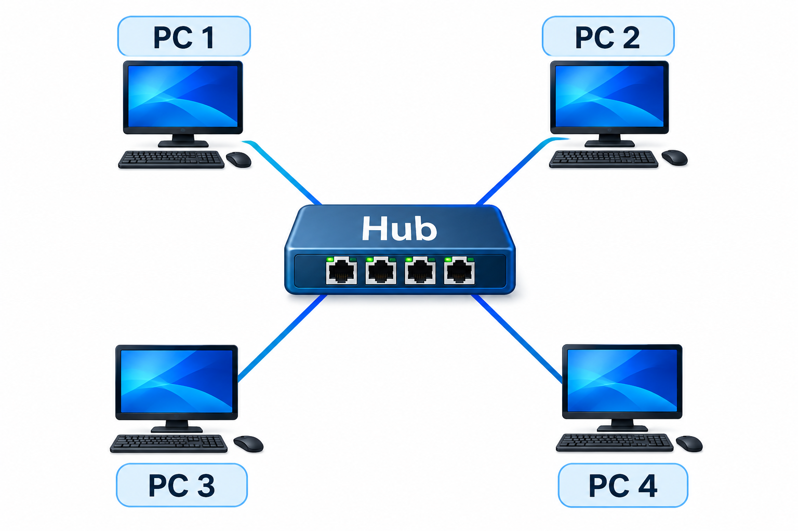
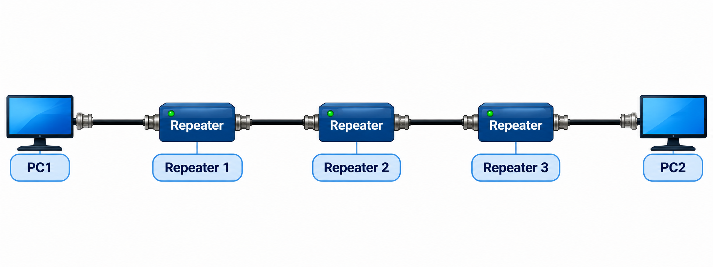
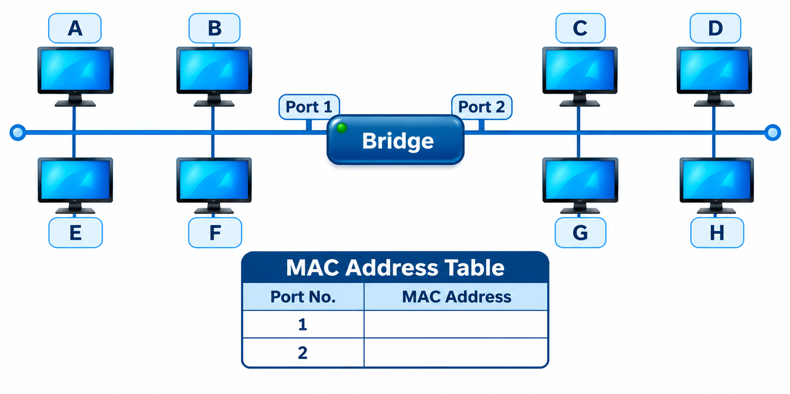
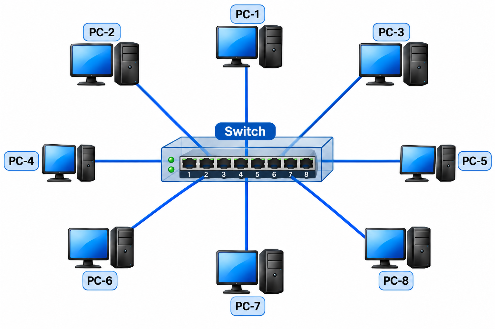
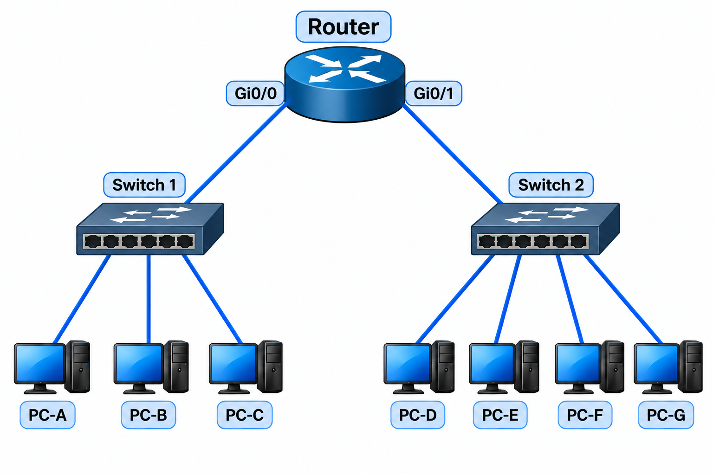

# Types of Networking Devices
**Physical Layer to Network Layer | Hub, Repeater, Bridge, Switch, Router & Default Gateway**

Networking devices are used to establish communication between two or more devices or networks.

Different networking devices perform different functions depending on the OSI layer at which they operate. Some devices connect devices within the same network, while others enable communication between different networks.

In this chapter, we will study:
1. Hub
2. Repeater
3. Bridge
4. Layer 2 Switch
5. Router
6. Default Gateway

## 1. Networking Devices and OSI Model
Different networking devices operate at different layers of the OSI model.
| OSI Layer | Networking Device |
| --- | --- |
| Layer 1 – Physical | Hub, Repeater |
| Layer 2 – Data Link | Bridge, Layer 2 Switch |
| Layer 3 – Network | Router, Layer 3 Switch |
| Higher Layers | Gateway (depending on its type and function) |

Understanding: Hub and Repeater work with physical signals and bits. Bridges and switches work with MAC addresses and Ethernet frames. Routers work with IP addresses and packets.

## 2. Hub

A Hub is a non-intelligent networking device that operates at Layer 1 (Physical Layer) of the OSI model.

It is used to connect multiple devices within a Local Area Network (LAN).
### Working of Hub

A hub always broadcasts incoming data to all its other connected ports.

Consider an example where four computers (PC1, PC2, PC3 and PC4) are connected to a hub.

Suppose PC1 wants to send data to PC4.

I. PC1 sends data to the hub.

II. The hub receives the incoming bits.

III. The hub forwards those bits to all other connected devices (PC2, PC3 and PC4).

IV. All three devices receive the transmitted frame.

V. Each receiving device checks the Destination MAC address.

VI. PC2 and PC3 discard the frame because the Destination MAC address does not match theirs.

VII. PC4 accepts the frame because the Destination MAC address matches its MAC address.

**Important:** The hub itself does not understand MAC addresses or IP addresses. It simply repeats incoming signals to its other ports.
### Security Risk
Since a hub forwards incoming data to all connected devices, every connected device receives the transmitted traffic.

This creates a security risk because a device with suitable packet-capturing capabilities may inspect traffic that was intended for another device.

Therefore, hubs are less secure than switches in this regard.
### Important Characteristics of Hub
I. A hub is a non-intelligent networking device.
II. It operates at Layer 1 (Physical Layer).
III. It does not understand or maintain MAC addresses or IP addresses.
IV. It does not maintain a MAC address table or routing table.
V. It forwards incoming bits to all other connected ports.
VI. It operates in Half-Duplex mode in traditional shared Ethernet.
VII. It has a single collision domain, regardless of the number of ports.
VIII. It is generally used within a LAN.
IX. It requires devices to be in the same IP subnet for normal communication, but every device must have a unique IP address.
### Types of Hubs
There are two commonly described types of hubs:

I. Active Hub
   A. Requires electrical power to operate.
   B. Regenerates and amplify incoming signals.
   C. Helps transmit signals over longer distances.
II. Passive Hub
   A. Does not amplify or regenerate signals.
   B. Simply distributes incoming signals.
   C. Generally does not require external power.

## 3. Repeater

A Repeater is a networking device that operates at Layer 1 (Physical Layer) of the OSI model.

It is used to extend the transmission distance of a network by regenerating weakened signals.
### Why Do We Need a Repeater?
When data travels over a cable for a long distance, the transmitted signal becomes weaker due to attenuation.

Eventually, the receiving device may not be able to interpret the signal correctly.

To overcome this problem, we use a repeater.
### Working of Repeater
I. A signal travels through a network cable.
II. As the signal travels over a longer distance, it becomes weaker.
III. The repeater receives the weakened signal.
IV. It regenerates and retimes the signal.
V. The regenerated signal continues towards its destination.
### Example: 10BASE2 Ethernet

A 10BASE2 coaxial Ethernet segment supports a maximum cable segment length of approximately 185 metres.

If we need to extend the physical network beyond the supported segment length, repeaters can be used according to Ethernet's repeater and segment design rules.
### Important Characteristics of Repeater
I. A repeater is a non-intelligent networking device.
II. It operates at Layer 1 (Physical Layer).
III. It regenerates and retimes signals.
IV. It does not understand MAC addresses or IP addresses.
V. It does not maintain MAC or IP address tables.
VI. It requires electrical power.
VII. It is used to extend the physical transmission distance of a network.
VIII. It does not correct corrupted data or recover lost information.

## 4. Bridge

A Bridge is an intelligent networking device that operates at Layer 2 (Data Link Layer) of the OSI model.

It is used to connect multiple LAN segments and filter network traffic using MAC addresses.

Unlike a hub, a bridge can identify the destination MAC address and decide whether a frame needs to be forwarded to another segment.
### Working of Bridge
A bridge maintains a MAC address table that contains:
- MAC addresses of connected devices.
- The port through which each device can be reached.
Consider an example:

A two-port bridge has the following devices:
- Port 1: A, B, E and F.
- Port 2: C, D, G and H.
Initially, the bridge has an empty MAC address table.

### Case 1: A sends data to H

I. A sends a frame to H.

II. The bridge receives the frame on Port 1.

III. It checks the Source MAC address and learns that A is reachable through Port 1.

IV. It stores A's MAC address against Port 1 in its MAC address table.

V. The bridge checks the Destination MAC address.

VI. Since H is not present in its table, the bridge floods the frame through Port 2.

VII. H receives the frame, while the other devices discard it if the destination MAC does not match.

---

### Case 2: B sends data to H

I. B sends a frame to H.

II. The bridge receives it on Port 1.

III. It learns B's Source MAC address and associates it with Port 1.

IV. It checks the Destination MAC address.

V. It already knows that H is reachable through Port 2.

VI. Therefore, it forwards the frame only through Port 2.

This reduces unnecessary traffic on Port 1.

### How Does a Bridge Learn MAC Addresses?

A bridge learns MAC addresses from the Source MAC address of incoming frames.

**For example:**

- A frame arriving through Port 1 with Source MAC A teaches the bridge that A is reachable through Port 1.
- A frame arriving through Port 2 with Source MAC H teaches the bridge that H is reachable through Port 2.

**IMP NOTE:**

I. It does not learn MAC addresses from acknowledgements.

II. Bridge/Switch MAC learning is independent of TCP and UDP.

---

### Three Main Operations of a Bridge

I. **Learning:** Learns Source MAC addresses and their associated ports.

II. **Forwarding:** Forwards known unicast frames through the appropriate destination port.

III. **Flooding:** Floods unknown unicast and broadcast frames through all ports except the incoming port.

**Flooding:**

Flooding is the process of forwarding an incoming frame through all eligible ports except the port on which the frame was received.

If the source and destination are reachable through the same port, the bridge filters the frame instead of forwarding it to another segment.

---

### Important Characteristics of Bridge

I. It is an intelligent networking device.

II. It operates at Layer 2 (Data Link Layer).

III. It connects multiple LAN segments.

IV. It understands MAC addresses but does not use IP addresses for forwarding.

V. It maintains a MAC address table.

VI. It filters unnecessary traffic between LAN segments.

VII. Each bridge port represents a separate collision domain.

VIII. It reduces unnecessary traffic compared to a hub.

IX. It does not normally separate broadcast domains.

### Collision Domains in Bridge

The number of collision domains depends on the number of bridge ports.
| Number of Ports | Collision Domains |
| --- | --- |
| 2 | 2 |
| 4 | 4 |
| 8 | 8 |

## 5. Layer 2 Switch

A Layer 2 Switch is an intelligent networking device that operates at Layer 2 (Data Link Layer) of the OSI model.

It is used to connect multiple devices within a LAN and forwards Ethernet frames using MAC addresses.

A switch is more efficient than a hub because it does not unnecessarily forward every frame to every connected device.

### CAM Table

A Layer 2 switch maintains a table called the CAM Table (Content Addressable Memory).

**The CAM table stores:**

- MAC addresses of connected devices.
- The switch port associated with each MAC address.

**For example:**

| Port Number | MAC Address |
|:---:|:---:|
| Port 1 | PC1's MAC |
| Port 2 | PC2's MAC |
| Port 3 | PC3's MAC |
| Port 7 | PC7's MAC |

The switch uses this table to determine where to forward incoming Ethernet frames.

---

### Working of Switch

**Case 1: Destination MAC Address is Already Present**

Suppose PC1 wants to send a frame to PC7.

I. PC1 sends a frame to the switch.

II. The switch receives the frame.

III. It checks the Destination MAC address.

IV. It searches for the destination MAC address in its CAM table.

V. It finds that PC7 is connected to Port 7.

VI. The switch forwards the frame only through Port 7.

VII. PC7 receives the frame.

**This is called Unicast Forwarding.**

---

**Case 2: Destination MAC Address is Not Present**

Suppose PC1 wants to send a frame to PC7, but PC7's MAC address is not present in the CAM table.

I. PC1 sends the frame to the switch.

II. The switch receives the frame on Port 1.

III. It learns PC1's Source MAC address and stores it against Port 1.

IV. It checks the Destination MAC address.

V. Since PC7's MAC address is not present in the CAM table, the switch floods the frame through all other ports in the same VLAN.

VI. PC7 receives the frame and other devices discard it if the destination MAC does not match.

**This is called Unknown Unicast Flooding.**

---

### How Does a Switch Learn MAC Addresses?

A switch learns MAC addresses from the Source MAC address of incoming frames.

Consider a new switch with eight connected PCs.

Initially, its CAM table is empty.

I. PC1 sends a frame to PC7.

II. The frame arrives through Port 1.

III. The switch reads the Source MAC address.

IV. It learns that PC1 is connected through Port 1.

V. It updates its CAM table.

VI. It checks the Destination MAC address.

VII. Since PC7 is unknown, it floods the frame through all other ports.

VIII. PC7 receives the frame.

When PC7 sends a frame, the switch learns PC7's MAC address from the Source MAC address of that incoming frame and associates it with Port 7.

**Important:** The switch does not learn PC7's MAC address from an acknowledgement. It learns it when PC7 itself transmits a frame.

### What Happens When a Device Is Replaced?

Suppose a switch has eight connected PCs and its CAM table already contains all eight MAC addresses.

Now, we remove PC6 from Port 6 and connect a new device, PC10.

PC10 has a different MAC address.

I. PC1 wants to send data to PC10.

II. The switch checks its CAM table.

III. PC10's MAC address is not present.

IV. The switch floods the frame through all other ports.

V. When PC10 sends a frame, the switch learns its Source MAC address.

VI. The switch updates its CAM table and associates PC10's MAC address with Port 6.

The old MAC address entry will eventually be removed through MAC address aging if it is no longer refreshed.

---

### Types of Frame Forwarding

A switch can forward different types of traffic:

I. **Unicast:** Data is sent to one specific destination device.

II. **Broadcast:** Data is sent to all devices within the same broadcast domain (VLAN).

III. **Multicast:** Data is sent to a specific multicast group of devices.

Multicast traffic can be managed using features such as IGMP Snooping.

VLANs can help separate networks, but VLAN configuration alone does not select individual multicast receivers.

---

### Important Characteristics of Switch

I. A switch is an intelligent networking device.

II. It operates at Layer 2 (Data Link Layer).

III. It forwards frames using MAC addresses.

IV. It maintains a CAM table.

V. It learns MAC addresses from incoming frames.

VI. It supports Unicast, Broadcast and Multicast forwarding.

VII. It operates in Full-Duplex mode on standard full-duplex Ethernet links.

VIII. Every switch port represents a separate collision domain.

IX. It significantly reduces unnecessary traffic compared to a hub.

X. It is commonly used in LAN environments.

XI. Multiple devices connected to a switch can communicate simultaneously, subject to available switching and port capacity.

### Collision Domains in Switch
Every switch port has a separate collision domain.

For example, if an eight-port switch has eight connected PCs:
- PC1 is connected to Port 1.
- PC2 is connected to Port 2.
- PC3 is connected to Port 3.
- This continues up to PC8 on Port 8.
Therefore:
\[
\text{Collision Domains} = \text{Number of Switch Ports}
\]

For an eight-port switch, there are eight collision domains.
### Full-Duplex Communication
A full-duplex connection allows a device to send and receive data simultaneously.

For example:
- PC1 can send data to PC7.
- At the same time, PC7 can send data to PC1.
- PC4 can also send data to PC1 simultaneously.
The switch can receive frames from multiple ports and queue them for transmission through the same destination port.

Important: If PC4 and PC7 simultaneously send data to PC1, an Ethernet collision does not occur. The switch manages the incoming frames using buffering and queuing. Congestion may occur if the destination port cannot handle the incoming traffic rate.

### Types of Switches Based on Switching Methods

I. **Store-and-Forward Switch**

   A. Receives and stores the entire frame in its buffer.

   B. Checks the Frame Check Sequence (FCS) to detect transmission errors.

   C. Forwards the frame after checking it.

   D. More reliable, but adds some latency because it waits for the complete frame.

II. **Cut-Through Switch**

   A. Reads enough of the frame header to identify the Destination MAC address.

   B. Starts forwarding the frame without waiting for the entire frame.

   C. Faster and has lower latency.

   D. May forward corrupted frames because it does not wait to verify the complete frame's FCS.

III. **Fragment-Free Switch**

   A. Checks the first 64 bytes of the Ethernet frame before forwarding it.

   B. Helps avoid forwarding collision fragments.

   C. It is a compromise between Store-and-Forward and Cut-Through switching.

IV. **Adaptive Switch**

   A. Can dynamically select a switching method depending on network conditions and device implementation.

   B. It may use Store-and-Forward or Cut-Through switching based on its configuration or operating conditions.

### Switch Topology

The commonly used topology for connecting end devices to an Ethernet switch is **Star Topology**.

In a star topology, every PC has an individual connection to a central switch.

### 6. Router

A Router is an intelligent networking device that operates at **Layer 3 (Network Layer)** of the OSI model.

It is also known as an **Internetworking Device** because it enables communication between different IP networks.

Unlike hubs, bridges and Layer 2 switches, which are generally used to connect devices within the same LAN, routers are primarily used to connect different networks.

### Why Do We Need a Router?

Consider two different networks:

- **Network 1:** 10.0.0.0
- **Network 2:** 192.168.1.0

Suppose we want a device from Network 1 to communicate with a device from Network 2.

A Layer 2 switch alone cannot perform routing between these different IP networks.

We need a Layer 3 device, such as a **Router or Layer 3 Switch**, to establish communication between them.

### How Are Devices Connected to a Router?

Generally, in larger networks, we do not connect every PC directly to a router.

Instead, we use the following arrangement:

**PCs → Switch → Router**

For example:

- Multiple PCs are connected to a switch.
- The switch is connected to a router.
- Another switch is connected to the router's other interface.
- PCs connected to the second switch belong to another network.

This is a common arrangement in larger networks.

However, we can also connect a PC directly to a router if the router has a suitable interface and configuration.

### Router's Main Function

The primary function of a router is to **route IP packets from one network to another**.

When a router receives a packet, it checks the **Destination IP address** and consults its **Routing Table** to determine where the packet should be forwarded next.

The routing table contains information about available networks and the paths or next hops used to reach them.

### Practical Working of a Router (With Example)

Let's understand the practical working of a router with the help of an example.

#### 1. Network Topology

Consider a network in which one router has two ports (interfaces).

- **Port 1:** Connected to Switch 1, and Switch 1 is connected to PC-A, PC-B and PC-C.
- **Port 2:** Connected to Switch 2, and Switch 2 is connected to PC-D, PC-E, PC-F and PC-G.

The network configuration is as follows:

| Device / Interface | IP Address / Network ID |
|---|---|
| Router Port 1 | 10.0.0.0 Network |
| Router Port 2 | 192.168.1.0 Network |
| PC-A | 10.0.0.1 |
| PC-D | 192.168.1.1 |

Now, let's say PC-A wants to communicate with PC-D.

Since PC-A and PC-D belong to two different networks, they cannot communicate directly. They need a router to communicate with each other.

#### 2. Step-by-Step Working of a Router

**Step 1: PC-A Generates Data**

PC-A generates data that it wants to send to PC-D.

Since PC-D belongs to a different network, PC-A sends the data to its **Default Gateway (Router Port 1)**.

PC-A creates a frame containing:

- **Source MAC Address:** MAC address of PC-A.
- **Destination MAC Address:** MAC address of Router Port 1 (Default Gateway).

The IP packet contains:

- **Source IP Address:** 10.0.0.1 (PC-A).
- **Destination IP Address:** 192.168.1.1 (PC-D).

**Step 2: Frame Reaches the Router**

PC-A sends the frame to Switch 1.

Switch 1 forwards the frame to Router Port 1.

Now, the frame reaches the router.

**Step 3: Router Checks the Destination IP Address**

The router receives the frame, removes the Layer 2 header and checks the destination IP address of the packet.

The destination IP address is:

**192.168.1.1**

The router checks its routing table and identifies that the destination network (192.168.1.0) is connected to its Port 2.

Therefore, the router forwards the packet through Port 2.

**Step 4: Router Checks the ARP Table**

Before forwarding the packet, the router needs the MAC address of PC-D.

So, the router checks its **ARP table** to see whether the MAC address corresponding to PC-D's IP address (192.168.1.1) is available.

- **If the MAC address is available:** The router fetches the MAC address from its ARP table.
- **If the MAC address is not available:** The router broadcasts an ARP Request on the destination network to find PC-D's MAC address. PC-D replies with its MAC address.

**Step 5: Router Creates a New Frame**

Now, the router creates a new Layer 2 frame.

The new frame contains:

- **Source MAC Address:** MAC address of Router Port 2.
- **Destination MAC Address:** MAC address of PC-D.

The IP addresses remain unchanged:

- **Source IP Address:** 10.0.0.1 (PC-A).
- **Destination IP Address:** 192.168.1.1 (PC-D).

**Step 6: Data Reaches PC-D**

The router forwards the new frame through Port 2.

The frame reaches Switch 2, and Switch 2 forwards it to PC-D.

Finally, PC-D receives the data.

### Important Concept: IP Address vs MAC Address During Routing

This is one of the most important concepts in networking.

When a packet travels through a router:

- **Source IP address** generally remains the same.
- **Destination IP address** generally remains the same.
- **Source MAC address** changes at the next network hop.
- **Destination MAC address** also changes at the next network hop.

This assumes ordinary routing without NAT or other address transformations.

In simple words, IP addresses identify the original source and final destination, whereas MAC addresses are used for delivery over the current Layer 2 link.

### Important Characteristics of Router

I. A router is an intelligent networking device.

II. It operates at Layer 3 (Network Layer).

III. It is an internetworking device.

IV. It connects different IP networks.

V. It forwards packets using Destination IP addresses.

VI. It maintains a Routing Table.

VII. It determines the next hop or outgoing interface for packets.

VIII. Each routed interface belongs to its respective IP subnet.

IX. Each router interface forms a separate broadcast domain.

X. Routers do not forward Layer 2 broadcasts between interfaces by default.

XI. Routers can be used in both LAN and WAN environments.

XII. They are commonly used to connect different networks and provide connectivity to the Internet.

## 7. Default Gateway

A Default Gateway is the IP address of the router interface (or another Layer 3 gateway device) that a device uses to send packets to destinations outside its local IP network when no more specific route is available.

In simple words, the default gateway acts as the exit point from a local network to other networks.
### Why Do We Need a Default Gateway?
Suppose we have a network:
- Network ID: 10.0.0.0
- PC1: 10.0.0.1
- PC2: 10.0.0.2
Both PCs belong to the same network.

If PC1 wants to communicate with PC2, it can communicate directly through the switch.

However, suppose PC1 wants to communicate with a device in another network:

- Destination IP: 192.168.1.1

Now PC1 needs to send the packet outside its local network.

For this purpose, it sends the packet to its Default Gateway.
### Working of Default Gateway
Consider the following configuration:
| Device | IP Address |
| --- | --- |
| PC1 | 10.0.0.1 |
| PC2 | 10.0.0.2 |
| Router Port 1 | 10.0.0.254 |
| Router Port 2 | 192.168.1.254 |
| PC3 | 192.168.1.1 |

Here:
- PC1 belongs to 10.0.0.0 network.
- PC3 belongs to 192.168.1.0 network.
- Router connects both networks.
The Default Gateway of PC1 is:

10.0.0.254

The Default Gateway of PC3 is:

192.168.1.254

### Communication Process

I. PC1 wants to send data to PC3.

II. PC1 identifies that PC3 belongs to a different network.

III. PC1 prepares an IP packet with PC1's IP as the **Source IP** and PC3's IP as the **Destination IP**.

IV. PC1 sends the packet to its **Default Gateway (10.0.0.254)**.

V. The router receives the packet.

VI. The router checks the **Destination IP address**.

VII. It consults its **Routing Table**.

VIII. It forwards the packet through the interface connected to **192.168.1.0**.

IX. PC3 receives the packet.

### Important Characteristics of Default Gateway

I. It provides an exit point from a local network to other networks.

II. It is generally the IP address of a router interface on the local subnet.

III. It is configured on end devices such as PCs.

IV. It is used when the destination is outside the local network and no more specific route exists.

V. Devices belonging to different subnets generally have different default gateway addresses.

VI. A default gateway is not necessarily a separate physical device; it is a gateway function provided by a **Layer 3 device**.

### Important Difference: Router vs Default Gateway

A router is a physical or logical networking device that performs routing.

A default gateway is the next-hop IP address that a host uses to reach destinations outside its local network.

For example, Router Port 1 is physically connected to Network 1, and its IP address is 10.0.0.254. For the PCs in Network 1, 10.0.0.254 is their Default Gateway.

So, the default gateway is not the physical port itself. It is the IP address assigned to that router interface.

## 8. Comparison of All Networking Devices
This table will help you revise all the devices together.
| Feature | Hub | Repeater | Bridge | L2 Switch | Router |
| --- | --- | --- | --- | --- | --- |
| OSI Layer | L1 | L1 | L2 | L2 | L3 |
| Intelligence | No | No | Yes | Yes | Yes |
| Works with | Bits | Signals | MAC | MAC | IP |
| Maintains Table | No | No | MAC Table | CAM Table | Routing Table |
| Forwarding | All other ports | Regenerates signals | Selective | Selective | Based on IP |
| Duplex | Half | Depends on link | Depends on link | Full | Depends on interface |
| Collision Domains | 1 | Does not independently segment | One per port | One per port | One per interface |
| Separates Broadcast Domains | No | No | No | No (within same VLAN) | Yes |

## 9. Important Concepts – Quick Revision
### OSI Layer Mapping
I. Physical Layer (Layer 1)
   
   Hub and Repeater
II. Data Link Layer (Layer 2)
   
   Bridge and Layer 2 Switch
III. Network Layer (Layer 3)
   
   Router and Layer 3 Switch

### Tables Used by Networking Devices
| Device | Table |
| --- | --- |
| Hub | No table |
| Repeater | No table |
| Bridge | MAC Address Table |
| Switch | CAM Table |
| Router | Routing Table |

### Collision and Broadcast Domains
- Hub: One collision domain.
- Repeater: Does not split collision domains.
- Bridge: One collision domain per port; does not normally split broadcast domains.
- Switch: One collision domain per port; same VLAN shares a broadcast domain.
- Router: Each routed interface belongs to a separate broadcast domain.

## 10. Network Understanding

Consider the diagram

Suppose 10.0.0.1 wants to communicate with 192.168.1.1.
- PC1 uses 10.0.0.254 as its Default Gateway.
- The router receives the packet through Port 1.
- It checks the Destination IP address.
- It forwards the packet through Port 2.
- PC3 receives the packet.
This is the fundamental concept of inter-network communication.
