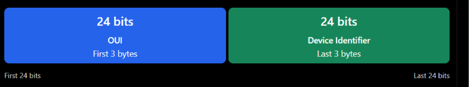

### MAC Address (Media Access Control Address)

### 1. Introduction to MAC Address

MAC Address stands for **Media Access Control Address**. It is also known as a **Physical Address** or **Hardware Address**.

- MAC Address is used to identify a **Network Interface Card (NIC)** within a Local Area Network (LAN).
- IP Address (Logical Address) is used for identifying and communicating with devices across different networks.
- MAC Address is generally used for communication within a local network, whereas IP Address is used for communication across networks.

**In simple words:**

- **IP Address:** Used for logical addressing and communication between networks.
- **MAC Address:** Used for identifying a network interface within a local network.

### 2. MAC Address Belongs to NIC, Not Directly to the Device

A common misconception is that a device has only one MAC Address. However, a MAC Address is associated with a **Network Interface Card (NIC)**, not necessarily with the entire device.

- Every network interface generally has its own MAC Address.
- A single device can have multiple NICs.
- Therefore, a device can have multiple MAC Addresses.

**Example:**

Suppose a laptop has 3 Network Interface Cards:

- Ethernet NIC
- Wi-Fi NIC
- Another Network Interface

In this case, the laptop can have 3 different MAC Addresses.

**General Rule:**

If a device has N network interfaces, it can have N MAC Addresses.

\[
\text{Number of MAC Addresses} \sim \text{Number of NICs}
\]

**Note:** A device can also have virtual interfaces, and some MAC addresses can be changed or locally assigned through software.

### 3. Uniqueness of MAC Address

- MAC Addresses are designed to be globally unique when assigned by manufacturers.
- Each manufacturer receives a unique identifier that helps distinguish its MAC Address assignments.
- However, MAC Addresses can be changed or spoofed through software, so they are not guaranteed to be unique in every real-world situation.

### 4. Structure of MAC Address

A standard MAC Address is **48 bits (6 bytes)** long.

It is divided into two parts:

**48-bit MAC Address**

**Part 1: OUI (Organizationally Unique Identifier) – First 24 Bits**

- The first 24 bits identify the organization or manufacturer that was assigned the address block.
- Different manufacturers, such as Intel, Dell and Lenovo, can have different OUIs.
- By checking the OUI, we can generally identify the manufacturer associated with a MAC Address.

**Part 2: Device Identifier – Last 24 Bits**

- The remaining 24 bits identify the individual interface within that assigned address block.
- A manufacturer can generate up to \(2^{24}\) different identifiers within one 24-bit block.

\[
2^{24} = 16,777,216
\]

If a manufacturer exhausts one assigned address block, it can obtain another block.

### 5. MAC Address Representation

- MAC Address is generally represented in **Hexadecimal Format (Base 16)**.
- Since 1 hexadecimal digit represents 4 bits, a 48-bit MAC Address requires 12 hexadecimal characters.

**Example:**

`00:1A:2B:3C:4D:5E`

Here:

- **00:1A:2B** → First 24 bits (OUI)
- **3C:4D:5E** → Last 24 bits (Device Identifier)

Other commonly used representations include:

- `00-1A-2B-3C-4D-5E`
- `001A.2B3C.4D5E`

All three represent the same MAC Address.

### 6. MAC Address Assignment Authority

- MAC Address blocks are assigned by **IEEE (Institute of Electrical and Electronics Engineers)**, specifically through the IEEE Registration Authority.
- IEEE assigns unique identifiers (OUIs) to different organizations or manufacturers.
- Manufacturers use their assigned address blocks to create MAC Addresses for their network interfaces.

**Example:**

I. Suppose a company receives an OUI (first 24 bits) from IEEE.

II. It can generate up to \(2^{24}\) different MAC Addresses using the remaining 24 bits.

III. Once that address block is exhausted, the company can obtain another address block from IEEE.

IV. This process continues as the company manufactures more network interfaces.

### 7. MAC Address of Switch and Router

**A. Switch**

- A switch has its own MAC Address.
- A typical Layer 2 switch uses a base MAC Address for its management and internal functions.
- Its individual physical ports do not generally require separate MAC Addresses.

**B. Router**

- A router has its own MAC Addresses.
- Generally, each Layer 3 interface of a router has a different MAC Address.
- Therefore, if a router has N physical Layer 3 interfaces, it generally has N interface MAC Addresses.

**Example:**

If a router has 3 Ethernet interfaces:

- Interface 1 → MAC Address 1
- Interface 2 → MAC Address 2
- Interface 3 → MAC Address 3

### 8. MAC Broadcast Address

A MAC Broadcast Address is used when a device wants to send a frame to all devices within the same broadcast domain (LAN).

The broadcast MAC Address is:

`FF:FF:FF:FF:FF:FF`

### Quick Revision

| Property | MAC Address |
|---|---|
| Full Form | Media Access Control |
| Also Known As | Physical / Hardware Address |
| Size | 48 bits (6 bytes) |
| Format | Hexadecimal |
| Total Characters | 12 |
| First 24 Bits | OUI |
| Last 24 Bits | Device Identifier |
| Assignment Authority | IEEE |
| Broadcast Address | FF:FF:FF:FF:FF:FF |
| Associated With | Network Interface Card (NIC) |
