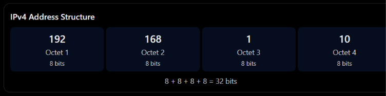
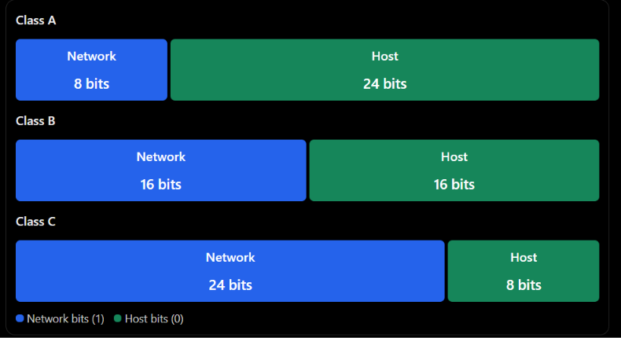
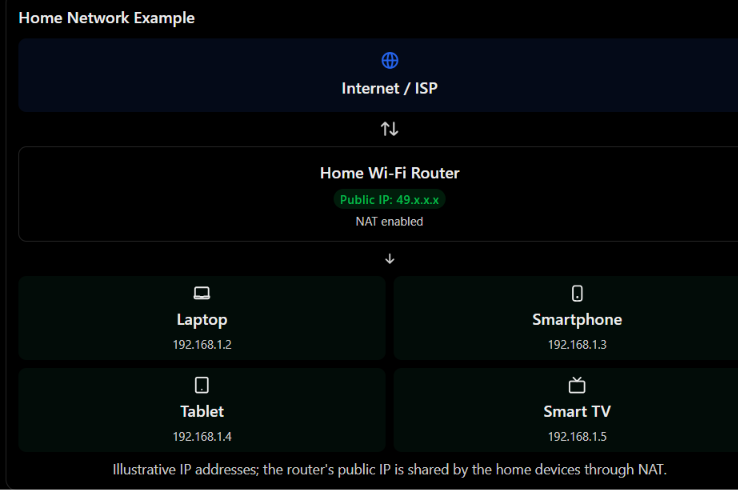
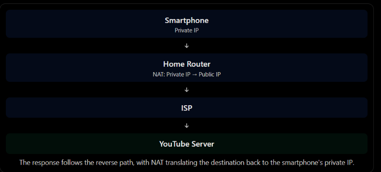

### IP Address (Internet Protocol Address)

### 1. Introduction to IP Address

IP Address is a **logical address** assigned to a network interface to identify it within a network and enable communication between devices.

There are two types of addresses used in networking:

I. **Physical Address (MAC Address):** Used for communication within a Local Area Network (LAN).

II. **Logical Address (IP Address):** Used for logical addressing and communication between different networks.

**In simple words:**

- **MAC Address** → Physical Address
- **IP Address** → Logical Address

### 2. Types of IP Addresses

IP Addresses are mainly classified into two versions:

I. **IPv4 (Internet Protocol Version 4)**

II. **IPv6 (Internet Protocol Version 6)**

IPv4 is further classified into two types based on usage:

- Private IP Address
- Public IP Address

In this section, we will study IPv4.

### 3. IPv4 (Internet Protocol Version 4)

**Definition:** IPv4 is a 32-bit logical address used to identify a network interface in an IP network.

**Characteristics:**

I. IPv4 is a 32-bit address.

II. It is divided into 4 parts called **Octets**.

III. Each octet contains 8 bits (1 byte).

IV. Each octet can have a decimal value ranging from 0 to 255.

V. An IPv4 address has two logical parts:

   A. Network part

   B. Host part

**Example:**

`192.168.1.10`



**Why does each octet have a value between 0 and 255?**

An octet contains 8 bits.

- **Minimum value:** 00000000 = 0
- **Maximum value:** 11111111 = 255

Therefore, each octet can have a value between 0 and 255.

2^8 = 256 possible values

### 4. Classes of IPv4 Addresses (Classful Addressing)

IPv4 addresses are traditionally divided into five classes:

- Class A
- Class B
- Class C
- Class D
- Class E

The classes commonly discussed for regular unicast addressing are Class A, Class B and Class C.

**A. IPv4 Address Classes**

| Class | First Octet Range | Full Address Range | Purpose |
|---|---|---|---|
| A | 1–126 | 1.0.0.0 – 126.255.255.255 | Unicast |
| B | 128–191 | 128.0.0.0 – 191.255.255.255 | Unicast |
| C | 192–223 | 192.0.0.0 – 223.255.255.255 | Unicast |
| D | 224–239 | 224.0.0.0 – 239.255.255.255 | Multicast |
| E | 240–255 | 240.0.0.0 – 255.255.255.255 | Experimental / Reserved |

**Special IP Address:**

`127.0.0.0/8` is reserved for loopback purposes.

- It is generally used for localhost.
- It allows a device to communicate with itself.
- **Example:** 127.0.0.1

**B. How to Identify the Class of an IP Address?**

We can identify the class of an IPv4 address by looking at its first octet.

**Examples:**

- 10.0.0.1 → Class A (First octet = 10)
- 137.2.3.4 → Class B (First octet = 137)
- 198.1.2.3 → Class C (First octet = 198)

### 5. Network ID and Host ID

An IPv4 address has two parts:

I. **Network ID:** Identifies the network to which a device belongs.

II. **Host ID:** Identifies a particular device (host) within that network.

In Classful Addressing, the division between Network ID and Host ID depends on the class of the IP address.

**A. Network and Host Division**

| Class | Network Portion | Host Portion |
|---|---|---|
| Class A | First 1 Octet | Last 3 Octets |
| Class B | First 2 Octets | Last 2 Octets |
| Class C | First 3 Octets | Last 1 Octet |

**Representation:**

- Network portion is represented by 1 bits.
- Host portion is represented by 0 bits.



**B. How to Find the Network ID?**

To find the Network ID:

- Keep the Network portion as it is.
- Change all Host portion bits to 0.

**Examples:**

| Given IP Address | Class | Network ID |
|---|---|---|
| 116.2.3.4 | A | 116.0.0.0 |
| 157.1.2.3 | B | 157.1.0.0 |
| 198.1.2.3 | C | 198.1.2.0 |

**Remember:**

- **Class A** → Keep 1st octet, make remaining 3 octets zero.
- **Class B** → Keep 1st 2 octets, make remaining 2 octets zero.
- **Class C** → Keep 1st 3 octets, make last octet zero.

### 6. Subnet Mask

**Definition:** A Subnet Mask is a 32-bit number used to identify which portion of an IP address represents the Network ID and which portion represents the Host ID.

**A. How to Calculate a Subnet Mask?**

To calculate a subnet mask:

I. Convert the IP address structure into 32 bits.

II. Make all Network bits 1.

III. Make all Host bits 0.

IV. Convert the resulting binary value into decimal.

**Example:**

For Class A:

```text
Network bits = 11111111
Host bits    = 00000000.00000000.00000000
```

Therefore:

```text
11111111.00000000.00000000.00000000
```

In decimal:

```text
255.0.0.0
```

**B. Default Subnet Masks**

In Classful Addressing, each class has a default subnet mask.

| Class | Network Bits | Host Bits | Default Subnet Mask | CIDR |
|---|---:|---:|---|---|
| A | 8 | 24 | 255.0.0.0 | /8 |
| B | 16 | 16 | 255.255.0.0 | /16 |
| C | 24 | 8 | 255.255.255.0 | /24 |

**Class A:**

- First 8 bits are reserved for the Network.
- Remaining 24 bits are reserved for Hosts.
- Subnet Mask = 255.0.0.0
- CIDR = /8

**Class B:**

- First 16 bits are reserved for the Network.
- Remaining 16 bits are reserved for Hosts.
- Subnet Mask = 255.255.0.0
- CIDR = /16

**Class C:**

- First 24 bits are reserved for the Network.
- Remaining 8 bits are reserved for Hosts.
- Subnet Mask = 255.255.255.0
- CIDR = /24

**C. Two Ways to Represent a Subnet Mask**

A subnet mask can be represented in two ways:

**1. Decimal Notation**

```text
255.0.0.0
255.255.0.0
255.255.255.0
```

**2. CIDR Notation (Slash Notation)**

```text
/8
/16
/24
```

The number after / represents the total number of bits reserved for the Network portion.

**Examples:**

- /8 → 8 Network bits.
- /16 → 16 Network bits.
- /24 → 24 Network bits.
- /10 → 10 Network bits.

For example, /10 in binary:

```text
11111111.11000000.00000000.00000000
```

In decimal:

```text
255.192.0.0
```

**Important:** Whenever you are asked to find the subnet mask, first identify how many bits are reserved for the Network portion. Make those bits 1 and the remaining Host bits 0. Then convert the binary value into decimal.

### 7. Private IP Address vs Public IP Address

There are two types of IPv4 addresses based on their usage:

I. Private IP Address

II. Public IP Address

**A. Private IP Address**

A Private IP Address is used for communication within a private network, such as a home, office or college network.

- Private IP addresses are used within LANs.
- They are not directly routable over the public Internet.
- We do not need to purchase globally unique public addresses for every device using private IPs.
- Multiple devices within a private network can have different private IP addresses.

**B. Public IP Address**

A Public IP Address is used for communication over the Internet.

- Public IP addresses are globally routable.
- They are assigned by ISPs or through the relevant address allocation process.
- A public IP address is generally provided by an ISP for an Internet connection.
- Public IP addresses are globally coordinated to avoid duplicate assignments.

**C. How Private and Public IP Addresses Work Together**

Let's understand this with an example.

Suppose we have a home Wi-Fi router connected to the Internet.

The router has a Public IP Address, and multiple devices are connected to it.

**For example:**

- Laptop
- Smartphone
- Tablet
- Smart TV

The router assigns a different Private IP Address to each device.



**D. Communication Flow: Smartphone to YouTube Server**

Suppose your smartphone sends a request to YouTube.

The communication flow is:

**Step 1: Smartphone → Home Router**

- The smartphone generates a request for YouTube.
- The request contains the smartphone's Private IP Address as its source IP.
- The request reaches the home router.

**Step 2: Home Router → ISP**

- The router uses NAT (Network Address Translation).
- It translates the private source IP into its Public IP Address.
- It also keeps track of the connection so that it can identify the device when the response arrives.

**Step 3: ISP → YouTube Server**

- The request travels through the ISP's network and other Internet routers.
- Finally, it reaches the YouTube server.

**Step 4: YouTube Server → ISP → Home Router**

- YouTube sends a response.
- The response travels back through the Internet and reaches the home router.

**Step 5: Home Router → Smartphone**

- The router checks its NAT translation table.
- It identifies the smartphone's connection.
- It forwards the response to the correct device using its Private IP Address.

**Complete Communication Flow:**



**Remember:** Multiple devices in a home network can share a single Public IP Address using NAT (Network Address Translation).

**E. Private IP Address Ranges**

Each of the traditional IP classes has a reserved Private IP Address range.

| Class | Private IP Address Range |
|---|---|
| Class A | 10.0.0.0 – 10.255.255.255 |
| Class B | 172.16.0.0 – 172.31.255.255 |
| Class C | 192.168.0.0 – 192.168.255.255 |

**Quick Way to Remember:**

- **Class A:** 10.x.x.x
- **Class B:** 172.16.x.x to 172.31.x.x
- **Class C:** 192.168.x.x

**Note:** These are the private address ranges defined by RFC 1918. They are also represented as 10.0.0.0/8, 172.16.0.0/12 and 192.168.0.0/16.

### 8. Number of Hosts in an IPv4 Network

An important question in IPv4 networking is:

**How many hosts can we connect within a particular network?**

The number of hosts depends on the number of bits reserved for the Host portion.

There are two important formulas:

**1. Total Number of IP Addresses**

2^Number of Host Bits

**2. Number of Usable Host IP Addresses**

2^(Number of Host Bits) -2

**Why do we subtract 2?**

Because in a traditional IPv4 subnet:

I. One IP Address is reserved for the Network ID.

II. One IP Address is reserved for the Broadcast Address.

Therefore, these two addresses cannot be assigned to regular hosts.

**A. Number of Hosts in Class A, B and C**

In Classful Addressing:

| Class | Network Bits | Host Bits | Total IPs | Usable Hosts |
|---|---:|---:|---:|---:|
| A | 8 | 24 | 2^24 | 2^24 -2 |
| B | 16 | 16 | 2^16 | 2^16 -2) |
| C | 24 | 8 | 2^8 | 2^8 -2 |

**Example: Class A**

- Network bits = 8
- Host bits = 24

**Total IP Addresses:**

2^24=16,777,216

**Usable Host IP Addresses:**

2^24 -2=16,777,214

Therefore, a traditional Class A network can have 16,777,214 usable host addresses.

**B. Network ID and Broadcast Address**

Two important addresses in an IPv4 network are:

**1. Network ID**

- The Network ID identifies a particular network.
- To calculate it, keep all Network bits as they are and make all Host bits 0.

**2. Broadcast Address**

- The Broadcast Address is used to send data to all devices within the same broadcast domain.
- To calculate it, keep all Network bits as they are and make all Host bits 1.

**C. How to Calculate Network ID and Broadcast Address?**

For Class A:

- Network portion = First Octet.
- Host portion = Remaining Three Octets.

Therefore:

| Address Type | Class A |
|---|---|
| Network ID | First Octet remains same, remaining octets become 0 |
| Broadcast Address | First Octet remains same, remaining octets become 255 |

**Example:**

Given IP Address:

```text
10.1.2.3
```

**Network ID:**

```text
10.0.0.0
```

**Broadcast Address:**

```text
10.255.255.255
```

**D. More Examples**

| Given IP Address | Class | Network ID | Broadcast Address |
|---|---|---|---|
| 11.200.200.200 | A | 11.0.0.0 | 11.255.255.255 |
| 123.1.2.3 | A | 123.0.0.0 | 123.255.255.255 |
| 157.1.2.3 | B | 157.1.0.0 | 157.1.255.255 |
| 198.1.2.3 | C | 198.1.2.0 | 198.1.2.255 |

### 9. Solved Example: 11.200.200.200

Suppose we are given the following IP Address:

```text
11.200.200.200
```

**Step 1: Identify the Class**

The first octet is 11.

Since 11 belongs to the range 1–126, it is a Class A IP Address.

**Step 2: Identify Network and Host Bits**

- Network bits = 8
- Host bits = 24

**Step 3: Find Network ID**

Keep the first octet as it is and make the remaining three octets zero.

**Network ID = 11.0.0.0**

**Step 4: Find Broadcast Address**

Keep the first octet as it is and make the remaining three octets 255.

**Broadcast Address = 11.255.255.255**

**Step 5: Calculate Total IP Addresses**

2^24=16,777,216

**Step 6: Calculate Usable Host IP Addresses**

2^24-2=16,777,214

**Final Answer**

| Property | Value |
|---|---|
| IP Address | 11.200.200.200 |
| Class | A |
| Network Bits | 8 |
| Host Bits | 24 |
| Subnet Mask | 255.0.0.0 |
| Network ID | 11.0.0.0 |
| Broadcast Address | 11.255.255.255 |
| Total IP Addresses | 16,777,216 |
| Usable Host Addresses | 16,777,214 |

### Quick Revision – Important Formulas

| Concept | Formula / Rule |
|---|---|
| IPv4 Size | 32 bits |
| Number of Octets | 4 |
| Bits per Octet | 8 bits |
| Values per Octet | 0–255 |
| Total IP Addresses | 2^hc |
| Usable Host Addresses | 2^h-2 |
| Network ID | Host bits = 0 |
| Broadcast Address | Host bits = 1 |
| Subnet Mask | Network bits = 1, Host bits = 0 |
| CIDR | Number of Network bits |

Here, h represents the number of Host bits.

### Important Technical Notes

I. The formula 2^h -2 applies to traditional IPv4 subnets where network and broadcast addresses are reserved. There are exceptions such as /31 point-to-point links.

II. The number of hosts calculated above represents the capacity of a network/subnet, not the number of private IPs that can be connected to one public IP. NAT allows multiple private devices to share one public IP.

III. The class-based Network ID calculations above apply to Classful Addressing. Modern networks generally use CIDR, where the subnet mask determines the Network and Host portions.